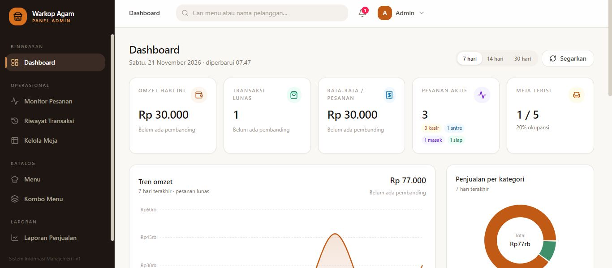
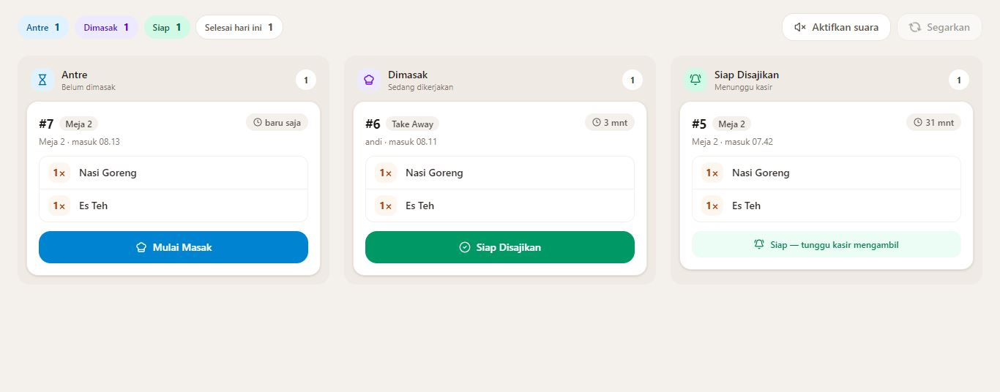
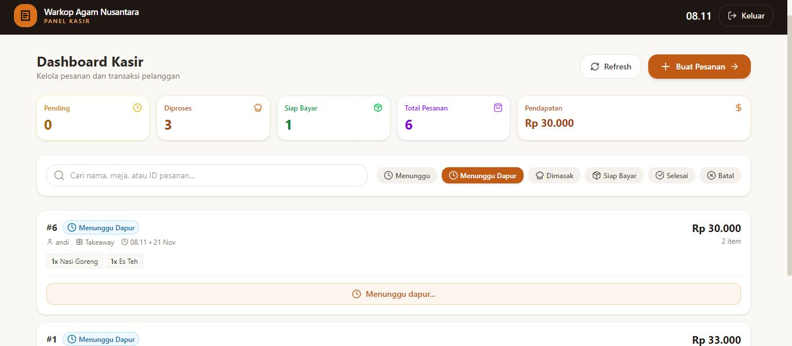
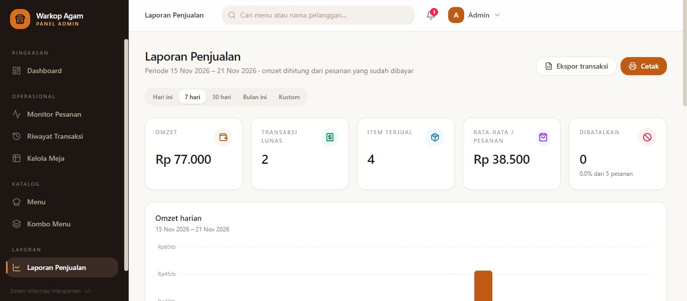
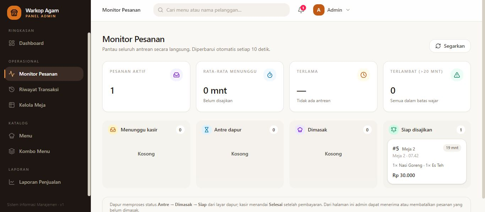
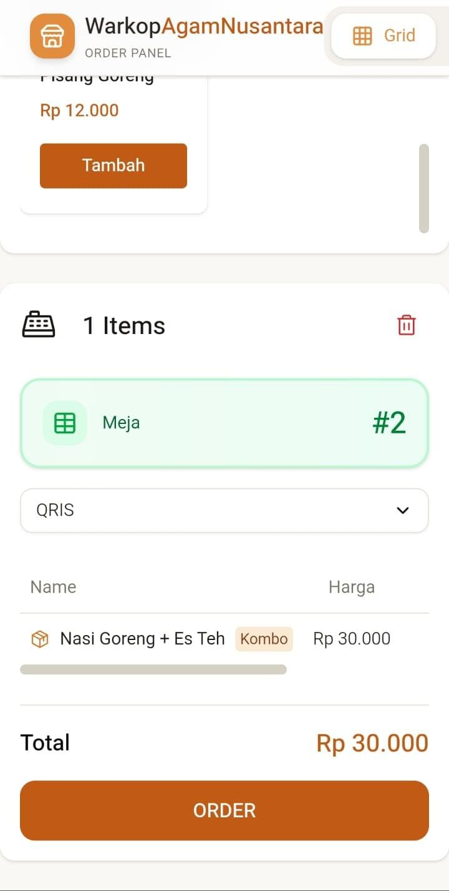
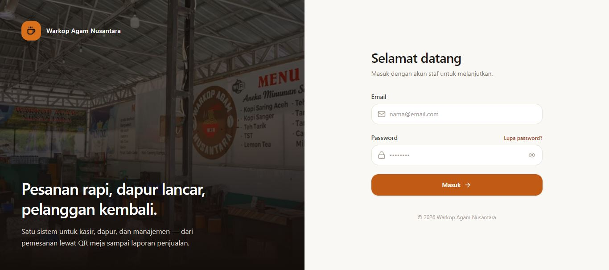

<div align="center">

# ☕ Warkop Agam Nusantara

**Sistem POS & Manajemen untuk Warkop** — pemesanan lewat QR meja, panel kasir, layar dapur, dan dashboard manajemen (MIS) dalam satu aplikasi.


</div>

---

## Daftar Isi

- [Tampilan Aplikasi](#tampilan-aplikasi)
- [Fitur](#fitur)
- [Peran & Halaman](#peran--halaman)
- [Alur Pesanan](#alur-pesanan)
- [Teknologi](#teknologi)
- [Memulai](#memulai)
- [Konfigurasi Environment](#konfigurasi-environment)
- [Menambah Akun Staf](#menambah-akun-staf)
- [QR Code Meja](#qr-code-meja)
- [Struktur Proyek](#struktur-proyek)
- [Keamanan](#keamanan)
- [Pemecahan Masalah](#pemecahan-masalah)
- [Skrip](#skrip)

## Tampilan Aplikasi

<!--
CARA MENAMBAH GAMBAR
1. Simpan screenshot di folder docs/screenshots/ (disarankan format .png atau .webp, lebar ~1600px).
2. Gunakan nama file huruf kecil tanpa spasi, mis. dashboard.png, dapur.png.
3. Ganti baris gambar di bawah, atau salin salah satu blok untuk menambah gambar baru.
Tips: ukuran file < 500 KB per gambar agar README cepat dimuat.
-->

### Dashboard Admin

<p align="center">
  
</p>

### Layar Dapur & Panel Kasir

<table>
  <tr>
    <td align="center" width="50%">
      
      <br /><sub><b>Layar Dapur</b></sub>
    </td>
    <td align="center" width="50%">
      
      <br /><sub><b>Panel Kasir</b></sub>
    </td>
  </tr>
</table>

### Laporan & Monitor Pesanan

<table>
  <tr>
    <td align="center" width="50%">
      
      <br /><sub><b>Laporan Penjualan</b></sub>
    </td>
    <td align="center" width="50%">
      
      <br /><sub><b>Monitor Pesanan</b></sub>
    </td>
  </tr>
</table>

### Pemesanan Pelanggan (QR Meja)

<p align="center">
  
</p>

### Halaman Login

<p align="center">
  
</p>

---

## Fitur

### 🧑‍🍳 Operasional
- **Pemesanan via QR meja** — pelanggan memindai QR di meja, memilih menu/kombo, dan memilih metode bayar tanpa login.
- **Panel kasir** — terima/tolak pesanan, buat pesanan walk-in, tandai selesai (dibayar), cetak struk.
- **Layar dapur** — papan antrean 3 kolom (Antre → Dimasak → Siap), penanda pesanan lama, bunyi notifikasi pesanan baru, update status cepat.

### 📊 Dashboard Admin (gaya MIS)
- **Dashboard** — KPI hari ini (omzet, transaksi, rata-rata per pesanan, pesanan aktif, okupansi meja) dengan perbandingan vs kemarin; tren omzet 7/14/30 hari; penjualan per kategori; jam sibuk; menu terlaris; komposisi metode bayar & tipe pesanan; monitor meja; transaksi terbaru.
- **Monitor Pesanan** — pantau seluruh antrean secara langsung, waktu tunggu rata-rata, pesanan terlambat.
- **Laporan Penjualan** — rentang tanggal bebas, rekap harian & per menu, **ekspor CSV**, dan **cetak**.
- **Riwayat Transaksi** — pencarian, filter status, paginasi, detail pesanan, ekspor CSV.
- **Kelola Menu, Kombo, dan Meja** — termasuk unduh/ganti QR meja.

## Peran & Halaman

| Peran  | Halaman | Fungsi |
|--------|---------|--------|
| `admin` | `/dashboard` | Dashboard MIS, monitor pesanan, laporan, riwayat, kelola menu/kombo/meja |
| `kasir` | `/cashier` | Terima/tolak pesanan, walk-in, pembayaran, cetak struk |
| `dapur` | `/dapur` | Antrean masak |
| publik  | `/kasir/<token>` | Pelanggan memesan lewat QR meja |

Akses halaman dan API dibatasi per peran berdasarkan JWT yang ditandatangani server.

## Alur Pesanan

```
pending ──► waiting ──► preparing ──► done ──► finish
   │           │
   └───────────┴──► cancelled
```

| Transisi | Dilakukan oleh |
|----------|----------------|
| `pending → waiting` (diterima kasir) | kasir, admin |
| `waiting → preparing` (mulai masak) | dapur, admin |
| `preparing → done` (siap disajikan) | dapur, admin |
| `done → finish` (dibayar) | kasir, admin |
| `pending / waiting → cancelled` | kasir, admin |

Efek samping ditangani atomik di server (`src/lib/order-status.js`): meja menjadi *occupied* saat diterima, kembali *available* saat selesai/batal, dan statistik menu bertambah saat selesai.

## Teknologi

- **Framework:** Next.js 16 (App Router, Turbopack) + React 19
- **Styling:** Tailwind CSS 4, ikon Lucide, grafik Recharts
- **Database:** PostgreSQL via Prisma ORM (kompatibel dengan Supabase)
- **Autentikasi:** Firebase Authentication → sesi JWT (HttpOnly cookie, `jose`)
- **Lainnya:** `qrcode` (generator QR), `react-hot-toast`

## Memulai

### Prasyarat
- Node.js 20+
- Database PostgreSQL (lokal atau Supabase)
- Proyek Firebase dengan *Email/Password* aktif

### Instalasi

```bash
git clone <url-repo-anda>
cd warkop-agam-nusantara

npm install
cp .env.example .env          # lalu isi semua nilai

npx prisma db push            # membuat tabel dari prisma/schema.prisma
npm run seed                  # opsional: metode bayar, meja, menu contoh, akun staf contoh
npm run dev                   # http://localhost:3000
```

> Repo ini belum menyertakan folder `prisma/migrations`, sehingga `prisma db push` adalah cara termudah untuk memulai. Untuk produksi, disarankan membuat migrasi dengan `npx prisma migrate dev`.

## Konfigurasi Environment

Salin `.env.example` ke `.env`:

| Variabel | Keterangan |
|----------|------------|
| `DATABASE_URL` | Koneksi PostgreSQL. Di Supabase gunakan pooler (port 6543) dengan `?pgbouncer=true&connection_limit=10&pool_timeout=30` |
| `DIRECT_URL` | Koneksi langsung (port 5432) untuk migrasi/`db push` |
| `JWT_SECRET` | Rahasia penanda tangan sesi, **minimal 32 karakter** |
| `NEXT_PUBLIC_APP_URL` | URL publik aplikasi — dipakai untuk membuat link QR meja |
| `NEXT_PUBLIC_FIREBASE_*` | Konfigurasi web Firebase (publik) |
| `FB_PROJECT_ID`, `FB_CLIENT_EMAIL`, `FB_PRIVATE_KEY` | Kredensial **Firebase Admin** (rahasia) dari *Project settings → Service accounts* |
| `APP_TIMEZONE` | Opsional, zona waktu notifikasi (default `Asia/Jakarta`) |

Membuat `JWT_SECRET`:

```bash
node -e "console.log(require('crypto').randomBytes(48).toString('base64url'))"
```

## Menambah Akun Staf

1. Buat user (email + password) di **Firebase Console → Authentication**.
2. Tambahkan baris di tabel `admin_account` dengan `uid` = UID user Firebase tersebut dan `role` = `admin` / `kasir` / `dapur`.

> `prisma/seed.js` berisi UID contoh milik proyek Firebase lama. Ganti lewat env `SEED_ADMIN_UID`, `SEED_KASIR_UID`, `SEED_DAPUR_UID` sebelum menjalankan seed.

## QR Code Meja

- Setiap meja memiliki **satu QR permanen**: cetak sekali, tempel di meja, dipakai semua pelanggan berulang kali.
- Unduh QR di **Dashboard → Kelola Meja → Download QR**. Mengunduh ulang **tidak** mengubah QR.
- Tombol **ganti QR** (ikon refresh) membuat token baru dan **mematikan QR lama** — gunakan hanya jika QR bocor atau disalahgunakan.
- Pengaman spam: satu meja dibatasi **3 pesanan** yang menunggu konfirmasi kasir (`MAX_PENDING_PER_TABLE` di `src/app/api/cart/route.js`).
- Pastikan `NEXT_PUBLIC_APP_URL` berisi domain publik sebelum mencetak; jika masih `localhost`, QR tidak bisa dipindai dari HP pelanggan.

## Struktur Proyek

```
src/
├── app/
│   ├── page.jsx                  # Login staf
│   ├── (admin)/dashboard/        # Dashboard, pesanan, laporan, history, menu, kombo, meja
│   ├── cashier/                  # Panel kasir
│   ├── (dapur)/dapur/            # Layar dapur
│   ├── (kasir)/kasir/[token]/    # Halaman pemesanan pelanggan (QR)
│   └── api/                      # Route handler (orders, cart, menu, table, ...)
├── components/dashboard/         # Komponen UI bersama (StatCard, DateRange, ...)
├── lib/
│   ├── auth.js · api-auth.js     # JWT, guard peran, sesi geser
│   ├── order-status.js           # State machine pesanan
│   ├── analytics.js              # Perhitungan KPI/laporan
│   ├── format.js                 # Format rupiah, tanggal, CSV
│   └── validation.js
├── proxy.js                      # Proteksi route berdasarkan peran (Next.js 16)
prisma/
├── schema.prisma
└── seed.js
```

## Keamanan

- Login: browser mengirim **ID token Firebase**; server memverifikasinya dengan Firebase Admin lalu menerbitkan cookie sesi JWT (HttpOnly, 8 jam). `src/proxy.js` dan setiap API memverifikasi tanda tangan JWT.
- **Sesi geser**: sesi diperpanjang otomatis saat layar aktif (maks. 24 jam sejak login), sehingga layar dapur/kasir tidak kedaluwarsa diam-diam.
- Harga pesanan **selalu dihitung di server** dari database; klien hanya mengirim id dan jumlah.
- Pembatalan/perubahan status divalidasi per peran dan bersifat atomik (mencegah balapan antar-staf).
- **Jangan pernah commit** `.env` atau file service account Firebase (sudah ada di `.gitignore`).

## Pemecahan Masalah

**`P2028: Unable to start a transaction in the given time`**
Pool koneksi Prisma penuh (umum terjadi di pooler Supabase). Tambahkan `connection_limit` dan `pool_timeout` pada `DATABASE_URL` (lihat tabel environment). Aksi dapur (`preparing`/`done`) sudah tidak memakai transaksi interaktif.

**Dapur tidak bisa mengubah status / muncul "Sesi login berakhir"**
Login ulang. Sesi diperpanjang otomatis selama layar aktif, tetapi tetap berakhir 24 jam setelah login.

**QR meja "tidak dikenali"**
QR sudah diganti lewat tombol *ganti QR*, atau meja dihapus. Unduh dan cetak ulang QR terbaru dari halaman Kelola Meja.

**`JWT_SECRET belum diset atau terlalu pendek`**
Isi `JWT_SECRET` minimal 32 karakter di `.env`.

## Skrip

| Perintah | Fungsi |
|----------|--------|
| `npm run dev` | Menjalankan server pengembangan |
| `npm run build` | `prisma generate` + build produksi |
| `npm start` | Menjalankan hasil build |
| `npm run lint` | ESLint |
| `npm run seed` | Mengisi data awal |

---

<div align="center">Dibuat untuk Warkop Agam Nusantara ☕</div>
